<picture>
  <source media="(prefers-color-scheme: light)" srcset="./tagline-light.svg">
  
</picture>

 

  

<h3><code>suraj@dublin ~ $ whoami</code></h3>
<table>
  <tr>
    <td valign="top">
      <picture>
        <source media="(prefers-color-scheme: light)" srcset="./ascii-portrait-light.svg">
        
      </picture>
    </td>
    <td valign="top">
      <picture>
        <source media="(prefers-color-scheme: light)" srcset="./info-card-light.svg">
        
      </picture>
    </td>
  </tr>
</table>

 

<h3><code>suraj@dublin ~ $ git log career</code></h3>
<picture>
  <source media="(prefers-color-scheme: light)" srcset="./career-log-light.svg">
  
</picture>

  

<h3><code>suraj@dublin ~ $ ls ~/projects</code></h3>
<table>
  <tr>
    <th align="left">Project</th>
    <th align="left">What it does</th>
    <th align="left">Built with</th>
  </tr>
  <tr>
    <td><a href="https://github.com/surajrakeshgupta/Cyrillic-Guard"><b>Cyrillic-Guard</b></a> <a href="https://cyrillic-guard.vercel.app/">live demo</a></td>
    <td>Spots homograph phishing URLs that swap Latin letters for look-alike Cyrillic ones, like <code>fаcebook.com</code>. Grew out of my MSc dissertation on cross-cultural phishing.</td>
    <td>JavaScript, Bootstrap, Vercel</td>
  </tr>
  <tr>
    <td><a href="https://github.com/surajrakeshgupta/Security-Logs-Analysis-using-Federated-Learning"><b>Security Logs Analysis using Federated Learning</b></a></td>
    <td>Privacy-first threat detection on HDFS and Windows event logs using a federated learning approach, comparing Random Forest, Decision Tree, Naive Bayes and clustering models.</td>
    <td>Python, scikit-learn, pandas, Jupyter</td>
  </tr>
</table>

 

<h3><code>suraj@dublin ~ $ pip list</code></h3>
<picture>
  <source media="(prefers-color-scheme: light)" srcset="./toolkit-light.svg">
  
</picture>

<!--
Contribution graph: the daily workflow already builds it. Uncomment this
block once there's a few months of regular commits to show.

  

<h3><code>suraj@dublin ~ $ ./contributions.sh</code></h3>
<picture>
  <source media="(prefers-color-scheme: light)" srcset="./contrib-heatmap-light.svg">
  
</picture>
-->

  

Built with <a href="https://github.com/deepakshebani/animated-github-profile">animated-github-profile</a> (MIT): pure SVG, refreshed daily by GitHub Actions.

